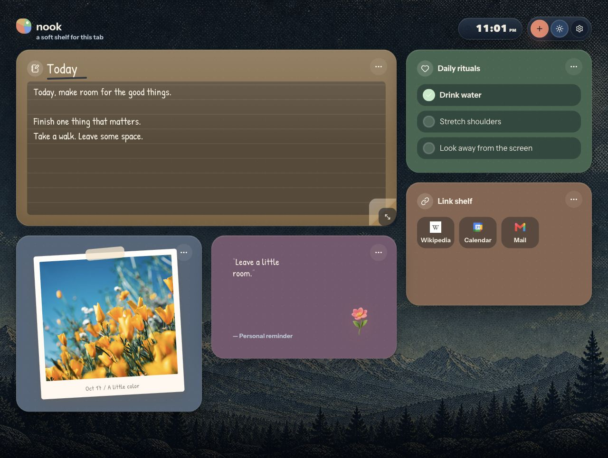
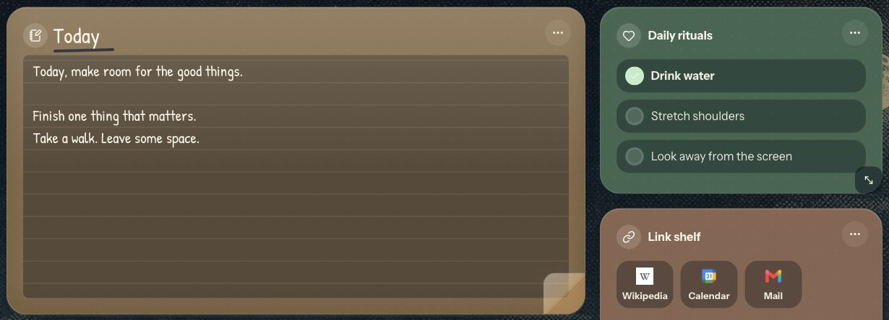
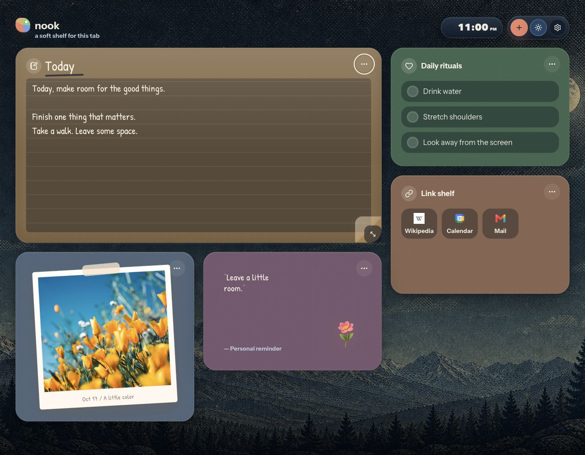
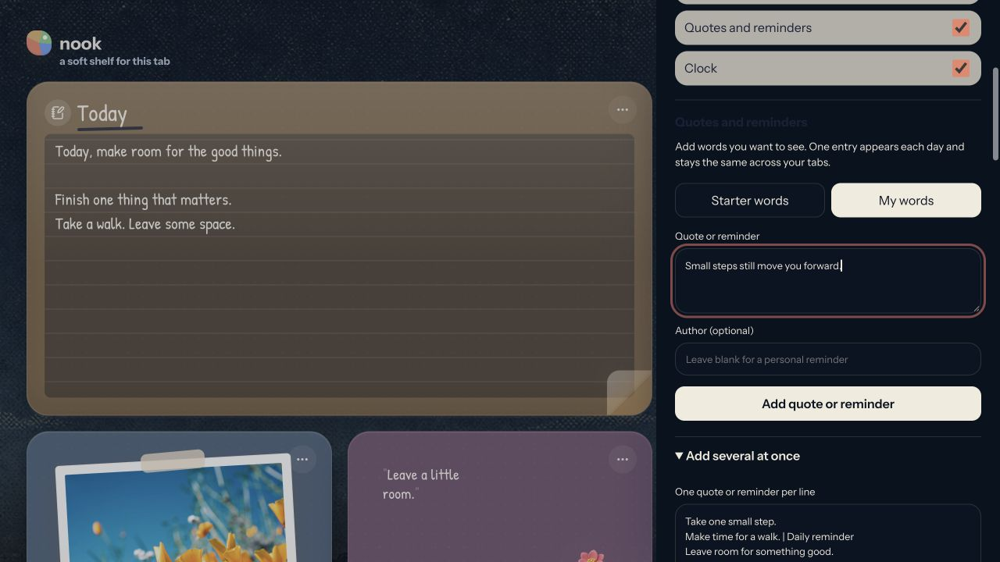
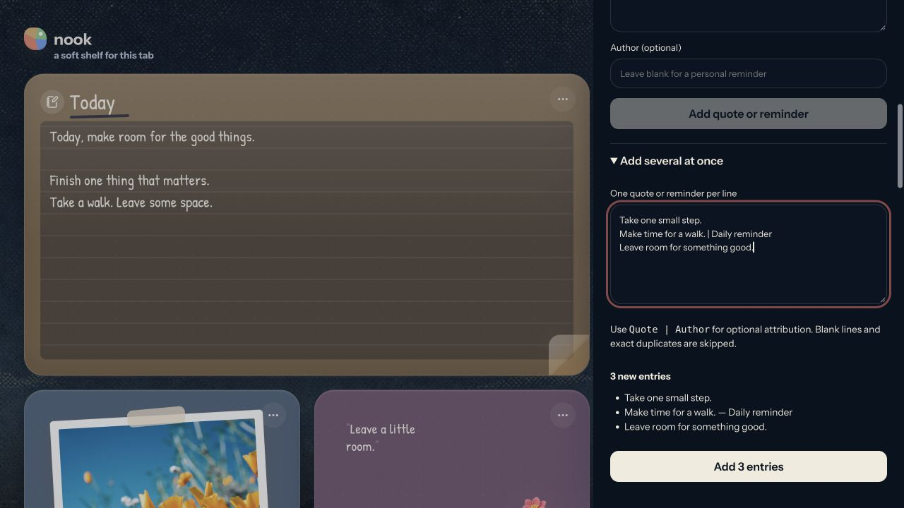
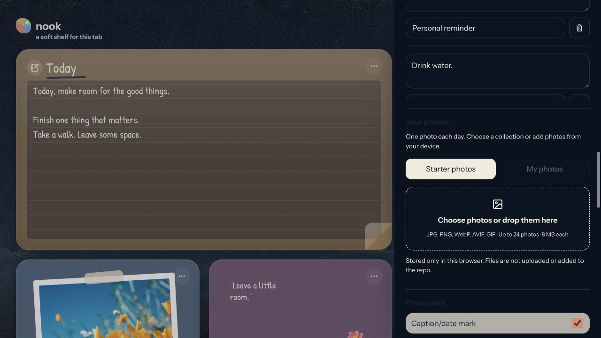
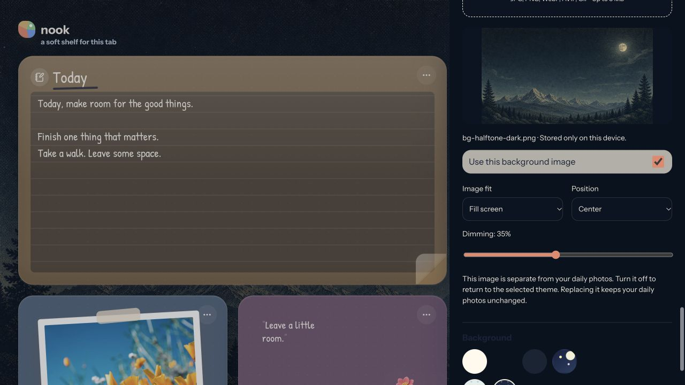

# Nook Template

**A new tab page that feels like home.**

A cloneable Chrome and Edge extension with a quiet dashboard. Make room for your notes, favorite links, daily rituals, photos, and words you want to remember. No account, server, or API key is required.



## Make it feel like home

- Move widgets with their three-dot handles. A live preview shows where each piece will snap.
- Resize from the bottom-right corner. The handle appears on hover or keyboard focus, and stays visible on touch devices.
- Edit your note directly on the page.
- Add links and rituals in Settings; show or hide each widget.
- Add your own quotes and reminders, one at a time or in bulk, with optional authors. One entry rotates in each day.
- Choose local photos in Settings or use the starter collection. Photos change daily.
- Upload a page background and adjust its fit, position, and dimming, or use the built-in themes.

Your content and layouts stay on the device. Layouts are saved separately for wide, medium, and narrow screens. There is no cloud sync or portable backup yet.

The screenshots use **Halftone night**, the built-in dark theme with a mountain background. Select it in **Settings → Background**.

## Notes, rituals, and favorite links

Write directly in the note. Keep a short plan or give it more room for a full day. Check off your daily rituals and open your favorite links from the same page. Edit rituals and links in Settings.



## Arrange your space

Drag the three dots at the top right of a widget. The widget follows the pointer, a placeholder shows the snapped location, and nearby pieces move to make room. Drag the bottom-right control to resize. Release to save.



To work with a keyboard, Tab to a three-dot handle and use arrow keys to move. Use Shift plus arrow keys to resize. You can also focus a resize handle and use arrow keys. Escape cancels an active pointer change when you release the pointer. Normal text selection, typing, and link clicks do not drag the widget.

Settings → Layout offers **Balanced** and **Focus** starters. Choosing one resets the saved grid positions and sizes; it keeps your notes, links, rituals, photos, and daily words.

## Add quotes and reminders

1. Open **Settings** with the gear button.
2. Find **Quotes and reminders**.
3. Type a quote, thought, or reminder. Add an author if you want one.
4. Select **Add quote or reminder**. The app selects **My words**.
5. Edit saved entries below the form, or remove one with its trash button.



### Bulk entry

Open **Add several at once** in Quotes and reminders. Paste one entry per line. Use `Quote | Author` when you want attribution:

```text
Drink water.
Take one small step today.
Stay curious. | Personal reminder
```



The preview shows the new entries and duplicates it will skip. Blank lines and exact duplicates are ignored. Select **Add entries** to save the batch. A batch that exceeds the 100-entry limit is blocked until it fits; it is not silently cut short.

Use **Starter words** to return to the default collection. Personal entries stay saved when you switch collections. There is room for 100 entries, with up to 400 characters each and an optional author of up to 100 characters.

Selection uses the local calendar date. The same collection shows the same entry in every tab for that day. Entries change at midnight, or when a sleeping tab becomes visible again. Adding or removing entries can change today's selection. Blank entries are skipped; an empty personal collection uses the starter words.

## Choose your images

Open **Settings → Your photos**. Use the file picker or drop files into the photo area. Acceptable types are JPG, PNG, WebP, AVIF, and GIF. Choose up to 24 files, at most 8 MB each.



Your selected files are saved in this browser profile. They stay on the device and are not uploaded, added to Git, or shared with people who clone the repo. Switch between **Starter photos** and **My photos**. One photo is selected per local day; there is no Next image button.

The preview and installed extension have separate photo libraries. Browser data clearing or extension removal can delete local photos, so keep the originals. See [the image guide](IMAGES.md) for storage details, offline use, and bundled or remote starter images.

## Upload a page background

Open **Settings → Background image**. Choose a local image or drop one onto the upload area. JPG, PNG, WebP, AVIF, and GIF files up to 8 MB are supported.

The image appears immediately and is saved on this device. Adjust **Image fit** (Fill screen, Show whole image, or Repeat image), **Position** (Center, Top, or Bottom), and **Dimming** (0–80%). Changes preview on the page and save automatically. Turn off **Use this background image** to return to the selected theme without deleting the file.



The wallpaper is stored separately from your daily photo collection. It does not rotate and does not count toward the 24-photo limit. Uploading a replacement does not change daily photos. Theme changes still control widget colors while a custom background is active.

## Start your own copy

Requirements: **Node.js 24 or later** and **PNPM 10**. The repo records PNPM 10.13.1 in `package.json`.

Use **Use this template** on GitHub when available, or clone the repository:

```sh
git clone https://github.com/kai-feinberg/nook-template.git my-nook
cd my-nook
pnpm install --frozen-lockfile
pnpm dev
```

Open the URL printed by Portless, then visit `/src/app/index.html`. The named host is `nook-template.localhost`; the URL can include a proxy port. For example:

```text
http://nook-template.localhost:1355/src/app/index.html
```

If the named preview cannot start, use `pnpm dev:direct` and open the Vite URL with `/src/app/index.html`.

## Make it your browser's new tab

```sh
pnpm build:extension
```

1. Open `chrome://extensions` in Chrome, or `edge://extensions` in Edge.
2. Enable **Developer mode**.
3. Select **Load unpacked**.
4. Select this repo's **dist** folder.
5. Open a new tab.

After source changes, build again and select **Reload** on the extension card. Keep the repo and `dist` folder on your computer while using the unpacked extension. If another extension owns your new tab page, disable its new tab override before testing Nook.

Firefox and Safari packages are not included. Browser preview checks and production builds have passed; unpacked extension installation has not been verified in this build.

## Customize the template in code

Start with [`src/template.config.ts`](src/template.config.ts). It defines the name, tagline, starter quotes, photos, links, rituals, note, widget visibility and order, starter sizes, background, and decorations.

| Change | File |
| --- | --- |
| Starter content and branding | `src/template.config.ts` |
| Colors, fonts, backgrounds, spacing | `src/app/styles/styles.css` |
| Widget content and Settings | `src/app/App.tsx` |
| Drag, resize, keyboard controls | `src/app/DashboardGrid.tsx` |
| Initial grid placement | `src/layouts/placement.ts` |
| Extension name and description | `src/extension/manifest.json` |
| Browser page title | `src/app/index.html` |

Saved personal settings take priority over starter defaults. **Reset to starter dashboard** restores defaults and deletes saved notes, links, rituals, and personal words after confirmation. It switches to Starter photos, but leaves local photo files in the library. A config change does not silently overwrite personal content.

Edit starter quotes and image collections in the config when you want them to ship with every clone. Put shareable image files in `src/app/assets/photos/` and import them. Read [CUSTOMIZATION.md](CUSTOMIZATION.md) for component changes and [IMAGES.md](IMAGES.md) for examples.

When running multiple clones at once, give each a different Portless name in the `dev` script. Brand changes also need an updated manifest name, HTML title, and package name.

## Generate a background

A reusable day and night wallpaper prompt is saved in [docs/prompts/background-image.md](docs/prompts/background-image.md). The file includes composition guidance, export suggestions, and two loading methods: upload in Settings for personal use, or bundle the image in code for every clone. It creates a quiet background behind the widgets; it does not replace the daily photo collection.

## Data and network access

The extension declares only the **storage** permission. It has no background worker or host permissions. Personal settings use `chrome.storage.local` in the extension and `localStorage` in the preview. Photos use IndexedDB.

The starter photo collection loads from Unsplash. Fonts load from Google Fonts, and quick-link icons use Google's favicon service. Those assets contact their source services when loaded. For offline photos, use bundled imports or selected local files. Use system fonts instead of the CSS font import if you want offline font loading.

## Checks and useful commands

```sh
pnpm test              # focused date, layout, and input checks
pnpm typecheck         # strict TypeScript check
pnpm build             # production extension output in dist
pnpm dev               # named local browser preview
pnpm dev:direct        # direct Vite preview
```

## Share the template

To publish your copy, create a remote repository, add its URL, and push:

```sh
git remote add origin <your-new-repository-url>
git push -u origin main
```

On GitHub, enable **Template repository** in repository settings to provide **Use this template**. Publish only source and assets you can share. Dependencies, build output, local environment files, tool caches, and internal planning notes are excluded from Git. Keep the README, customization and image guides, screenshots, and background image prompt with the template.

License: [MIT, with the existing ISC source notice retained](LICENSE). Third-party packages keep their own licenses. Check image rights before including images in a published template.
